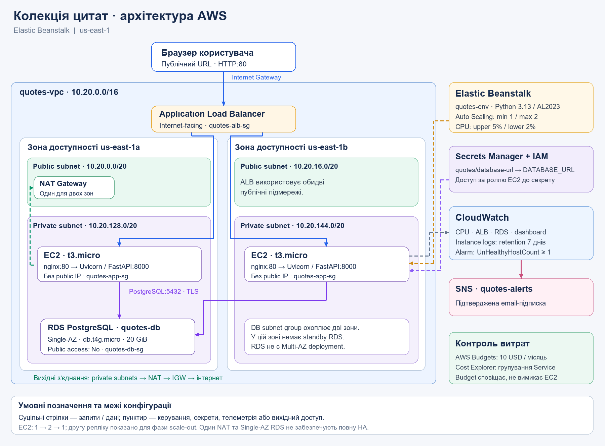

# Колекція цитат — фінальний проєкт GoIT Cloud Computing

Вебзастосунок з українським інтерфейсом: створення, редагування й видалення цитат, пошук за текстом та автором, категорії та випадкова цитата.

**Стек:** Python, FastAPI, SQLAlchemy, PostgreSQL, HTML/CSS/JavaScript.  
**AWS:** Elastic Beanstalk, ALB, Auto Scaling, RDS, VPC, IAM, Secrets Manager, CloudWatch, SNS, Budgets та Cost Explorer.

## Звіт і архітектура

- [Підсумковий звіт: архітектура, деплой, тестування, витрати та план очищення](docs/FINAL_REPORT.md).
- Схема архітектури: [PNG](img/00-architecture.png) · [SVG](img/00-architecture.svg).
- [Скриншоти реалізації](img/).



Навчальний стенд: <http://quotes-env.eba-9dpvcp9d.us-east-1.elasticbeanstalk.com>. Після очищення ресурсів URL перестане працювати; збережені докази містяться у звіті.

## Структура репозиторію

```text
app/
    app/                # FastAPI, init_db.py, seed.csv та статичний інтерфейс
    tests/              # HTTP-сценарії та перевірки імпорту CSV
    .ebextensions/      # ініціалізація БД під час деплою
    Procfile            # запуск Uvicorn у Beanstalk
    requirements.txt    # Python-залежності
    Dockerfile          # локальний Docker-образ
    compose.yaml        # PostgreSQL, init-db та вебзастосунок
    .env.example        # приклад локальних налаштувань
    load_test.py        # навантажувальний сценарій читання
    build_zip.py        # автоматичне збирання ZIP для Beanstalk
docs/FINAL_REPORT.md     # підсумковий звіт, дозволений у Git
img/                    # скриншоти й схема PNG/SVG
```

Інші робочі матеріали в `docs/` і файли з префіксами `tmp` та `task` виключено через кореневий `.gitignore`. Для `docs/FINAL_REPORT.md` додано окремий виняток. Локальні `.env`, `.venv`, кеші Python, `*.db` і `app/quotes-eb.zip` виключено через `app/.gitignore`.

## Локальний запуск

Потрібні Docker і Docker Compose. Із кореня репозиторію:

```powershell
cd app
Copy-Item .env.example .env
docker compose up --build -d
```

Застосунок: <http://localhost:8000>, API: <http://localhost:8000/docs>, перевірка стану: <http://localhost:8000/health>. PostgreSQL зберігає дані в Docker volume. Реквізити в `.env.example` призначені для локального прикладу; власні секрети зберігати в `.env`.

```powershell
docker compose logs web
docker compose down
```

## Початкові дані

`python -m app.init_db` створює таблицю та завантажує `app/app/seed.csv` лише в порожню таблицю. Поточний файл містить 50 цитат. Повторна ініціалізація непорожньої таблиці не дублює записи й не перезаписує зміни.

CSV: UTF-8, роздільник-кома, заголовок `text,author,category`. Текст обов’язковий; автор і категорія можуть бути порожніми. Ліміти: 5000, 200 та 100 символів відповідно. Для власного файла, за налаштованого `DATABASE_URL`, виконати з каталогу `app/`:

```powershell
python -m app.init_db --seed ./my-seed.csv
```

## Тестування

Із каталогу `app/` у Python-середовищі зі встановленими залежностями:

```powershell
python -m pip install -r requirements.txt
python -m unittest discover -s tests -v
```

Локальні тести використовують тимчасову SQLite; для перевірки PostgreSQL запустити Compose та перевірити CRUD і `/health`. Навантажувальний тест із кореня репозиторію:

```powershell
python app/load_test.py --url http://localhost:8000 --duration 900 --workers 10
```

## Підготовка ZIP для Elastic Beanstalk

Для Python-платформи Beanstalk Docker не потрібний. Із кореня репозиторію виконати:

```powershell
python app/build_zip.py
```

Або з каталогу `app/`:

```powershell
python build_zip.py
```

Потрібен лише Python, без додаткових залежностей. Скрипт створює або перезаписує `app/quotes-eb.zip` незалежно від поточного робочого каталогу. Перед збиранням перевіряє наявність усіх потрібних файлів і включає лише наведений нижче список; `.env`, `.venv`, локальні БД, тести та кеші в архів не потрапляють. Сам ZIP виключено з Git.

Структура готового архіву:

```text
Procfile
requirements.txt
.ebextensions/01_init_db.config
app/
    __init__.py
    main.py
    init_db.py
    seed.csv
    static/
        index.html
        app.js
        style.css
```

Скрипт включає прихований каталог `.ebextensions` і розміщує `Procfile` та `requirements.txt` у корені ZIP, без додаткової зовнішньої папки. Після змін коду або `seed.csv` повторно запустити команду. Якщо додаються нові файли застосунку, доповнити список `FILES` у `app/build_zip.py`.

ZIP завантажується в Beanstalk як Local file. `DATABASE_URL` передається через Secrets Manager. Параметри мережі, ролей, RDS, балансування й моніторингу наведено у [розділі 3 звіту](docs/FINAL_REPORT.md#3-деплой-вебзастосунку), порядок видалення ресурсів — у [розділі 7](docs/FINAL_REPORT.md#7-план-очищення-та-видалення-ресурсів).
